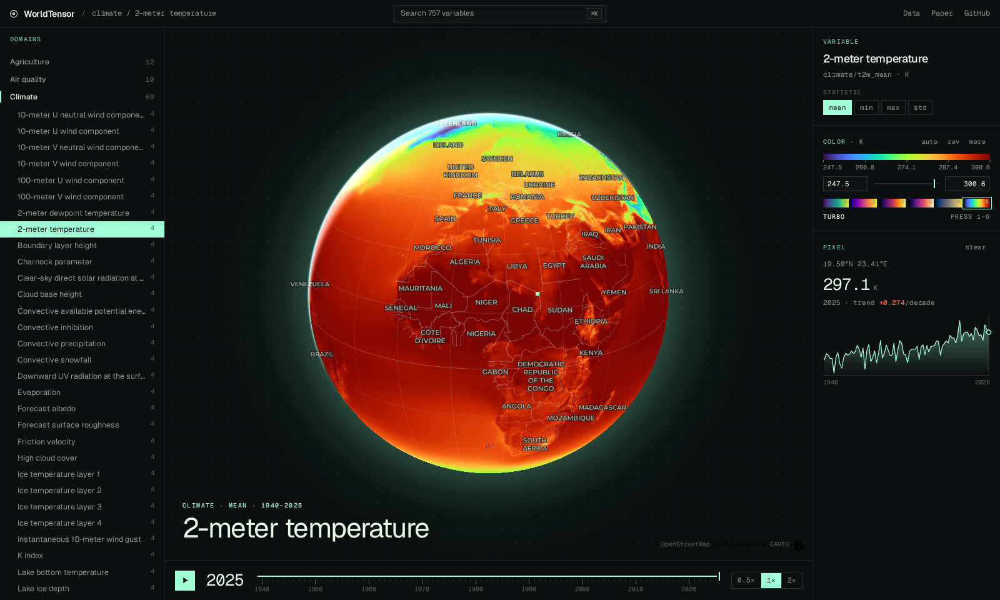

# WorldTensor (GeoZarr)

757 harmonized Earth-system variables on a common 0.25° global grid, mostly annual from 1900 to 2025. They cover climate, land use, ocean, cryosphere, hydrology, vegetation, emissions, air quality, energy, hazards, human systems and static soil and terrain layers. This is a cloud-native GeoZarr version of the [WorldTensor](https://arxiv.org/abs/2607.03298) release, built so it can be read straight from object storage.

**[Explore it in the browser →](https://research.taylorgeospatial.org/worldtensor-geozarr/)** · [Code and pipeline](https://github.com/taylor-geospatial/worldtensor-geozarr) · [Paper](https://arxiv.org/abs/2607.03298) · [Original release (Zenodo)](https://zenodo.org/records/19047618)



## Access

```
https://data.source.coop/tge-labs/worldtensor/worldtensor.zarr
s3://tge-labs/worldtensor/worldtensor.zarr   (endpoint https://data.source.coop)
```

```python
import xarray as xr

ds = xr.open_zarr("https://data.source.coop/tge-labs/worldtensor/worldtensor.zarr/climate/t2m_mean")
ds.t2m_mean.sel(time="2025", lat=48.85, lon=2.35, method="nearest")  # Paris, K
```

Each variable is its own self-contained group, `<domain>/<variable>`, for example `climate/tp_sum`, `ocean/chl_max` or `static/soil_properties/bdod_0-5cm_mean`. Each group has its own consolidated metadata, so opening one takes a single request. `catalog.json` at the store root lists every variable with its units, years, array shapes and a default color range.

## Layout

| array | shape / chunks | use |
|---|---|---|
| `<var>` | (years ×) 721 × 1440, chunks of 1 year × 361 × 360 | full resolution |
| `2x/<var>` | 1 year × 360 × 720 per chunk | global maps |
| `4x/<var>`, `8x/<var>` | all years in one chunk | animation and time sliders |
| `ts/<var>` | all years × 16 × 16 chunks in one shard | a pixel's full history (about 40 KB per read) |

- **Encoding:** Zarr v3, float32, lossless Blosc zstd level 9 with byte shuffle, NaN as nodata.
- **Grid:** EPSG:4326 cell centers, latitude ascending −90 → 90, longitude 0 → 359.75.
- **Overviews:** built by 2× averaging; the odd 90°N row is dropped so every level is exactly affine.
- **GeoZarr:** CF-1.8 grid mapping (WKT and GDAL `GeoTransform`) plus the zarr-conventions v0.1 `multiscales`, `proj:` and `spatial:` attributes. Every level validates against the official schemas and round-trips through rioxarray, and deck.gl-zarr opens it from its own metadata.

Values, units and variable semantics are unchanged from the source. In WorldTensor, a `_sum` suffix means a temporal aggregate per cell.

## Citation

```bibtex
@article{rodriguezpardo2026worldtensor,
  title   = {A harmonised dataset for Earth system foundation models},
  author  = {Rodriguez-Pardo, Carlos and Tavoni, Massimo},
  journal = {arXiv preprint arXiv:2607.03298},
  year    = {2026}
}

@dataset{rodriguezpardo2026worldtensor_data,
  title     = {Data for WorldTensor: A Harmonized Dataset for Earth System Foundation Models},
  author    = {Rodriguez-Pardo, Carlos and Tavoni, Massimo},
  year      = {2026},
  publisher = {Zenodo},
  doi       = {10.5281/zenodo.19047618}
}
```

## License

[CC BY 4.0](https://creativecommons.org/licenses/by/4.0/), inherited from the [original release](https://zenodo.org/records/19047618). This GeoZarr version was produced by [Taylor Geospatial](https://taylorgeospatial.org).
